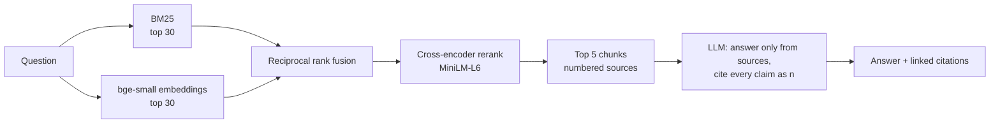

# AskDocs

**Ask questions about a documentation site and get grounded, cited answers, plus an evaluation harness that measures what each retrieval choice is actually worth.**

AskDocs indexes the [FastAPI docs](https://fastapi.tiangolo.com/) (155 pages) and answers questions with inline citations that link back to the exact section. It runs fully locally: ONNX embeddings and a cross-encoder on CPU, and any [Ollama](https://ollama.com) model for generation. Claude is supported as an optional provider.

The interesting part is the eval harness. Instead of assuming "hybrid search + reranking is better", it measures it on a 150-question golden set, across two chunking strategies and four retrieval modes.

## Results

150 questions, 124 distinct doc pages. Full table: [`eval/results/retrieval.md`](eval/results/retrieval.md).

| Chunking | Retrieval | Recall@1 | Recall@5 | Recall@10 | MRR@10 | p50 latency |
|---|---|---:|---:|---:|---:|---:|
| fixed 250-word windows | BM25 | 54.7% | 85.3% | 92.0% | 0.682 | 0.7 ms |
| fixed 250-word windows | dense | 52.0% | 83.3% | 91.3% | 0.666 | 7 ms |
| fixed 250-word windows | hybrid (RRF) | 63.3% | 89.3% | 92.0% | 0.740 | 8 ms |
| fixed 250-word windows | hybrid + rerank | 64.0% | 89.3% | 94.7% | 0.757 | 2.0 s |
| structure-aware | BM25 | 60.7% | 88.7% | 91.3% | 0.721 | 1.1 ms |
| structure-aware | dense | 72.0% | 93.3% | 97.3% | 0.813 | 7 ms |
| structure-aware | **hybrid (RRF)** | **73.3%** | 93.3% | 95.3% | **0.824** | 9 ms |
| structure-aware | **hybrid + rerank** | 72.0% | **96.0%** | **99.3%** | 0.818 | 2.0 s |

What the numbers say:

- **Chunking was the biggest single win.** Splitting on headings and prepending the heading breadcrumb to each chunk raised dense Recall@5 from 83.3% to 93.3% and Recall@1 from 52% to 72%. The model can't match a chunk to "how do I add CORS" if the chunk never says it is about CORS.
- **Hybrid beats either retriever alone** on both chunkings. BM25 catches exact identifiers (`Depends`, `response_model`); dense catches paraphrases. Reciprocal rank fusion combines them without tuning score scales.
- **The reranker widens recall but doesn't sharpen the top result.** It lifts Recall@5 from 93.3% to 96.0% (what actually lands in the LLM's context window) and Recall@10 to 99.3%, but MRR is flat and it costs ~2 s per query on CPU. With a 3B local generator taking ~10 s per answer that is an acceptable trade, so `hybrid-rerank` is the default; for a latency-sensitive API, plain `hybrid` is the better choice.

### End-to-end answers

The first 30 questions were answered by `llama3.2:3b` using the structure-aware index (k=5) and graded by `gemma3:4b`. Full records: [`eval/results/answers.json`](eval/results/answers.json).

| Retrieval | Judge: correct | Judge: faithful | Evidence in context | Answer cites the evidence chunk | Gen p50 |
|---|---:|---:|---:|---:|---:|
| BM25 | 96.7% | 100% | 83.3% | 40.0% | 2.3 s |
| hybrid + rerank | 96.7% | 100% | **100%** | **60.0%** | 2.2 s |

How to read this honestly: **the 4B judge saturated.** It rated almost everything correct and faithful, including BM25 answers where the evidence was never retrieved. The generator knows FastAPI from pretraining and filled the gap, and the judge didn't catch it. So the LLM-judged columns can't tell these two configurations apart. The mechanical columns can: with hybrid + rerank, the gold evidence reached the model's context every time (vs 83%), and the answer's own citations pointed at it 60% of the time (vs 40%). The fix is a stronger judge (`--judge-provider anthropic`) and a set of questions the model can't answer from memory. Both are on the list below.

## How it works



| Piece | Choice | Why |
|---|---|---|
| Chunking | Heading-aware, max 300 words, breadcrumb prefix, never splits inside a code fence | Measured +10 pts Recall@5 over fixed windows |
| Embeddings | `BAAI/bge-small-en-v1.5` via fastembed (ONNX, CPU) | Strong for its size, no GPU or API key |
| Vector store | A normalized numpy matrix | ~900 chunks: exact search takes under 1 ms. A vector DB would add infra without changing a single result |
| Lexical | BM25 (`rank-bm25`) with light stopword removal | Exact API names matter in technical docs |
| Fusion | Reciprocal rank fusion (k=60) | Uses ranks only, so no score normalization |
| Reranker | `ms-marco-MiniLM-L-6-v2` cross-encoder over the top 30 | See results |
| Generation | Ollama (default `llama3.2:3b`) or Claude | Prompt forbids outside knowledge and requires `[n]` citations; refusal string when sources don't cover it |

## Evaluation methodology

**Golden set.** `askdocs eval generate` samples chunks round-robin across pages and asks an LLM for a realistic question, a short reference answer, and a **verbatim quote** containing the answer. Items are rejected if the quote isn't actually in the source (9 of 166 attempts), if it's too short, or if the question references "the passage" or "the example above". The committed set is [`eval/datasets/fastapi_qa.jsonl`](eval/datasets/fastapi_qa.jsonl).

**Chunker-independent relevance.** A retrieved chunk counts as relevant if it's from the same page and contains at least 60% of the gold quote as one contiguous token run. Labeling by quote rather than chunk ID means the same question set can fairly score different chunking strategies, which is what makes the chunking comparison above possible.

**Metrics.** Recall@k means the evidence is in the top k. MRR@10 measures how high the evidence ranks. Doc recall@5 means the right page is in the top 5 even if it's the wrong section. Latency is measured after a warm-up query.

**Answer quality.** `askdocs eval answers` runs the full pipeline and has a separate judge model grade each answer for correctness against the reference and for faithfulness (no claims beyond the retrieved sources). It also checks mechanically whether the answer cited a chunk that contains the gold evidence.

### Limitations, stated plainly

- The questions are LLM-generated, so they're cleaner than real user queries. They may also share vocabulary with the source passage, which flatters BM25. The prompt asks for paraphrased, standalone questions, but a hand-labeled set of real queries would be a stronger benchmark.
- Answer grading uses a 4B local judge, which is noisy. Treat those numbers as directional; the retrieval metrics are exact.
- Code examples in the FastAPI docs are pulled in via include directives from `docs_src/`. They're stripped at ingest, so questions answerable only from code are under-served.

## Quickstart

Requires Python 3.10+, git, and [Ollama](https://ollama.com) (or an Anthropic API key).

```bash
git clone https://github.com/Yash06B/askdocs.git && cd askdocs
python -m venv .venv && source .venv/bin/activate   # Windows: .venv\Scripts\activate
pip install -e ".[dev]"
ollama pull llama3.2:3b

askdocs fetch                         # sparse-clone the FastAPI docs (~20 MB)
askdocs ingest --chunker markdown     # chunk + embed (~2 min on CPU)
askdocs ask "How do I return a custom status code?"
askdocs serve                         # web UI at http://127.0.0.1:8000
```

Using Claude instead: `pip install -e ".[anthropic]"`, set `ANTHROPIC_API_KEY`, then pass `--provider anthropic` (or set `ASKDOCS_PROVIDER=anthropic`). All settings are listed in [`.env.example`](.env.example).

### Reproduce the evals

```bash
askdocs ingest --chunker fixed                      # second index for the comparison
askdocs eval retrieval                              # every chunker x mode -> eval/results/retrieval.md
askdocs eval answers --n 30 --model llama3.2:3b \
    --judge-provider ollama --judge-model gemma3:4b # -> eval/results/answers.md
askdocs eval generate --n 150 --model gemma3:4b     # regenerate the golden set (optional)
```

### API

| Endpoint | |
|---|---|
| `POST /api/ask` `{"question": "...", "mode": "hybrid-rerank", "k": 5}` | Answer, citations, sources with links and scores, timings |
| `GET /api/search?q=...&mode=hybrid&k=5` | Retrieval only, no LLM |
| `GET /api/health` | Loaded index stats and LLM name |

### Use your own docs

Any folder of Markdown works:

```bash
askdocs ingest --source path/to/docs --name mydocs --url-base https://docs.example.com/
ASKDOCS_INDEX=mydocs askdocs serve
```

## Project layout

```
src/askdocs/
  chunking.py     markdown cleaning, heading-aware + fixed chunkers, citation URLs
  index.py        embedding, on-disk index (jsonl + npy)
  retrieve.py     BM25, dense, RRF fusion, cross-encoder rerank
  answer.py       grounded prompt, citation parsing
  llm.py          Ollama / Anthropic clients
  api.py          FastAPI app; web/index.html is the UI
  eval/           golden-set generation, relevance matching, retrieval + answer metrics
eval/datasets/    committed golden QA set
eval/results/     committed eval outputs
tests/            unit tests (no model downloads needed)
```

## What I'd do next

- A hand-labeled set of real user questions, to check that the synthetic-set conclusions hold.
- Contextual chunk enrichment (an LLM-written one-line summary per chunk) measured against the breadcrumb baseline.
- Query rewriting for vague questions, and a "no answer" subset to measure refusal precision.
- A stronger answer judge, plus questions about a private or post-cutoff corpus so the generator can't answer from memory.
- Swapping in a larger reranker. `bge-reranker-base` is wired up via `--rerank-models` but was too slow on a laptop CPU for 150 queries x 30 candidates.

## License

MIT
